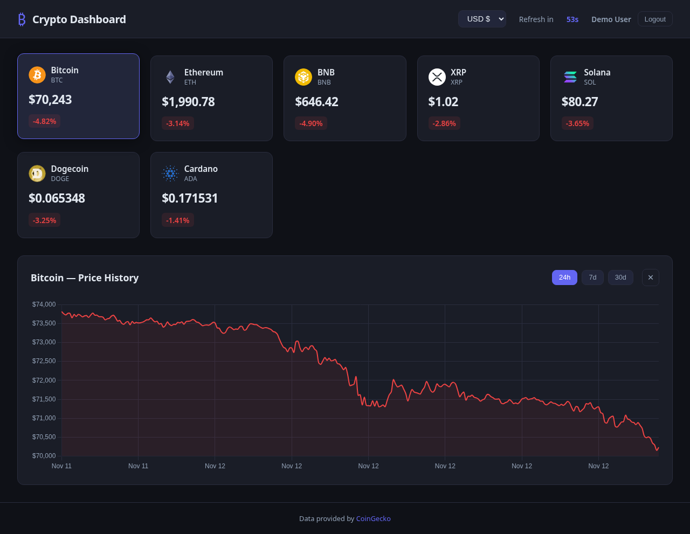
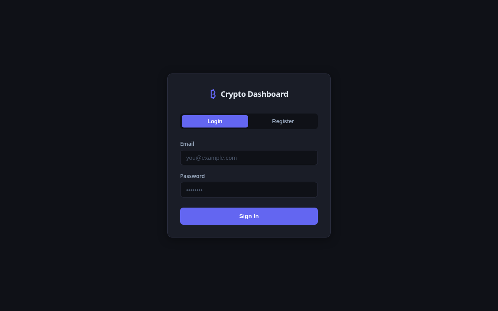

# 📊 Crypto Dashboard

A live cryptocurrency price dashboard with user accounts. It shows real-time market data for 7 major coins from the CoinGecko API, draws an interactive price-history chart for any coin, and refreshes automatically every 60 seconds. Sign-up and login are handled with Firebase Authentication.

🔗 **[Live Demo](https://coderblockch.github.io/crypto-dashboard/)** (create a free account on the Register tab to open the dashboard)



<details>
<summary>Login / Register screen</summary>



</details>

## Features

- 🔐 **Authentication** with Firebase Auth: register (name, email, password), sign in, and log out
- 👤 New users get a profile document in **Cloud Firestore**; the dashboard greets the signed-in user by name
- 🚧 **Protected route**: visitors who are not signed in are redirected to the login page
- 💰 **Live prices** for Bitcoin, Ethereum, Solana, BNB, XRP, Cardano, and Dogecoin, with 24h change shown in green or red
- 📈 **Price-history chart** (Chart.js): click a coin card to open it, then switch between 24h, 7d, and 30d
- 💱 **Currency switch** between USD and EUR
- ⏱️ **Auto-refresh** every 60 seconds with a visible countdown
- ⏳ Skeleton loading cards while data loads, and friendly error messages for common auth errors

## Tech Stack

- HTML5, CSS3 (custom dark theme)
- JavaScript (ES6 modules, `async/await`, Fetch API)
- [CoinGecko API](https://www.coingecko.com/en/api) for market and history data (no API key needed)
- [Chart.js](https://www.chartjs.org/) for charts
- [Firebase](https://firebase.google.com/) Authentication and Cloud Firestore (loaded from the Firebase CDN, no bundler)

## Run Locally

There is no build step, but the app uses ES modules, so it must be served over HTTP (opening the file directly will not work):

```bash
git clone https://github.com/coderblockch/crypto-dashboard.git
cd crypto-dashboard
python3 -m http.server 8000
# then open http://localhost:8000/login.html
```

To use your own Firebase project, replace the `firebaseConfig` object in `js/firebase.js` with your project's web config and enable **Email/Password** sign-in in the Firebase console.

## Project Structure

```
crypto-dashboard/
├── index.html      # dashboard (protected)
├── login.html      # login / register page
├── css/
│   ├── styles.css  # dashboard styles
│   └── auth.css    # login page styles
└── js/
    ├── app.js      # dashboard controller: auth guard, refresh timer, currency switch
    ├── api.js      # CoinGecko requests (markets + price history)
    ├── ui.js       # coin cards, price formatting, countdown
    ├── chart.js    # Chart.js price-history chart and range buttons
    ├── auth.js     # login / register form logic and error messages
    └── firebase.js # Firebase init, auth helpers, Firestore user profile
```

## Author

**David Jimenez**, Sacramento, CA · [GitHub @coderblockch](https://github.com/coderblockch) · [Portfolio](https://portfolio-bay-nine-59.vercel.app)
